# Modelo do banco de dados

<!-- Gerado por `npm run schema:diagram` (backend/scripts/schema-diagram.ts) a partir das migrations. Não edite à mão. -->

Gerado rodando todas as migrations em um SQLite em memória. Os tipos são os registrados pelo SQLite;
tabelas, colunas e relações são as mesmas do Postgres de produção.

20 tabelas. Legenda: PK chave primária, FK chave estrangeira, UK única.

```mermaid
erDiagram
    award_recipients {
        integer award_id PK, FK "→ awards"
        varchar user_email PK, FK "→ users"
    }
    awards {
        integer id PK
        integer organization_id FK "→ organizations"
        integer sports_team_id FK "nullable, → sports_teams"
        varchar kind
        varchar title
        varchar placement "nullable"
        varchar competition "nullable"
        integer year
        datetime created_at
        integer participation_id FK "nullable, → participations"
    }
    copa_editions {
        integer id PK
        varchar name
        integer year
        boolean is_current
    }
    edition_team_scoring {
        integer edition_id PK, FK "→ copa_editions"
        integer team_id PK, FK "→ teams"
        boolean bonus_torcida
        integer penalty_points
    }
    event_results {
        integer event_id PK, FK "→ events"
        integer team_id FK "→ teams"
        integer position PK
    }
    events {
        integer id PK
        varchar modality_code FK "→ modalities"
        varchar name
        boolean demonstrativa
        boolean revezamento
        boolean finished
        integer sort_order
    }
    matches {
        integer id PK
        varchar modality_code FK "→ modalities"
        varchar stage
        integer round
        integer position
        integer team_a_id FK "nullable, → teams"
        integer team_b_id FK "nullable, → teams"
        varchar score_a "nullable"
        varchar score_b "nullable"
        integer winner_id FK "nullable, → teams"
        integer next_match_id FK "nullable, → matches"
        varchar next_slot "nullable"
        varchar status
        datetime scheduled_at "nullable"
        integer venue_id FK "nullable, → venues"
        integer redator_team_id FK "nullable, → teams"
        integer mesario_team_id FK "nullable, → teams"
        boolean walkover
    }
    modalities {
        varchar code PK
        varchar name
        varchar type
        integer edition_id FK "nullable, → copa_editions"
        text short_code "nullable"
    }
    organization_positions {
        integer id PK
        integer organization_id FK "→ organizations"
        varchar user_email FK "→ users"
        varchar role
        varchar director_area "nullable"
        varchar started_on
        varchar ended_on "nullable"
    }
    organizations {
        integer id PK
        varchar name UK
        varchar description "nullable"
        text gradient
        text logo_url "nullable"
        text banner_url "nullable"
        text accent_color "nullable"
        text about "nullable"
        text instagram "nullable"
        text website "nullable"
        text contact_email "nullable"
        text store_url "nullable"
    }
    participation_athletes {
        integer participation_id PK, FK "→ participations"
        varchar user_email PK, FK "→ users"
    }
    participations {
        integer id PK
        varchar kind
        integer organization_id FK "→ organizations"
        integer sports_team_id FK "nullable, → sports_teams"
        varchar competition "nullable"
        integer year "nullable"
        integer placement "nullable"
        varchar modality_code FK "nullable, → modalities"
        integer copa_team_id FK "nullable, → teams"
        datetime created_at
    }
    permissions {
        varchar email FK "→ users"
        varchar permission
    }
    registrations {
        varchar modality_code PK, FK "→ modalities"
        integer team_id PK, FK "→ teams"
    }
    sports_team_stints {
        integer id PK
        integer team_id FK "→ sports_teams"
        varchar user_email FK "→ users"
        varchar role
        varchar started_on
        varchar ended_on "nullable"
    }
    sports_teams {
        integer id PK
        integer organization_id FK "→ organizations"
        varchar name
    }
    teams {
        integer id PK
        varchar name UK
        integer organization_id FK "nullable, → organizations"
    }
    time_slots {
        integer id PK
        datetime starts_at UK
        integer edition_id FK "nullable, → copa_editions"
    }
    users {
        varchar email PK
        varchar password
        varchar nickname
        text full_name "nullable"
        text ra UK "nullable"
        text cpf UK "nullable"
        text profile_photo_url "nullable"
    }
    venues {
        integer id PK
        varchar name
        integer parent_id FK "nullable, → venues"
    }

    users ||--o{ award_recipients : "user_email"
    awards ||--o{ award_recipients : "award_id"
    sports_teams |o--o{ awards : "sports_team_id"
    organizations ||--o{ awards : "organization_id"
    participations |o--o{ awards : "participation_id"
    teams ||--o{ edition_team_scoring : "team_id"
    copa_editions ||--o{ edition_team_scoring : "edition_id"
    teams ||--o{ event_results : "team_id"
    events ||--o{ event_results : "event_id"
    modalities ||--o{ events : "modality_code"
    matches |o--o{ matches : "next_match_id"
    teams |o--o{ matches : "winner_id"
    teams |o--o{ matches : "team_b_id"
    teams |o--o{ matches : "team_a_id"
    modalities ||--o{ matches : "modality_code"
    teams |o--o{ matches : "mesario_team_id"
    teams |o--o{ matches : "redator_team_id"
    venues |o--o{ matches : "venue_id"
    copa_editions |o--o{ modalities : "edition_id"
    users ||--o{ organization_positions : "user_email"
    organizations ||--o{ organization_positions : "organization_id"
    users ||--o{ participation_athletes : "user_email"
    participations ||--o{ participation_athletes : "participation_id"
    teams |o--o{ participations : "copa_team_id"
    modalities |o--o{ participations : "modality_code"
    sports_teams |o--o{ participations : "sports_team_id"
    organizations ||--o{ participations : "organization_id"
    users ||--o{ permissions : "email"
    teams ||--o{ registrations : "team_id"
    modalities ||--o{ registrations : "modality_code"
    users ||--o{ sports_team_stints : "user_email"
    sports_teams ||--o{ sports_team_stints : "team_id"
    organizations ||--o{ sports_teams : "organization_id"
    organizations |o--o{ teams : "organization_id"
    copa_editions |o--o{ time_slots : "edition_id"
    venues |o--o{ venues : "parent_id"
```

